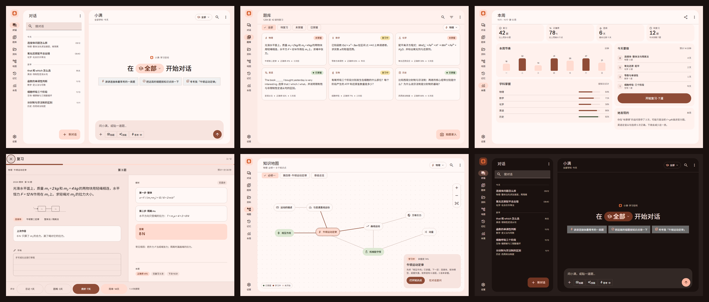
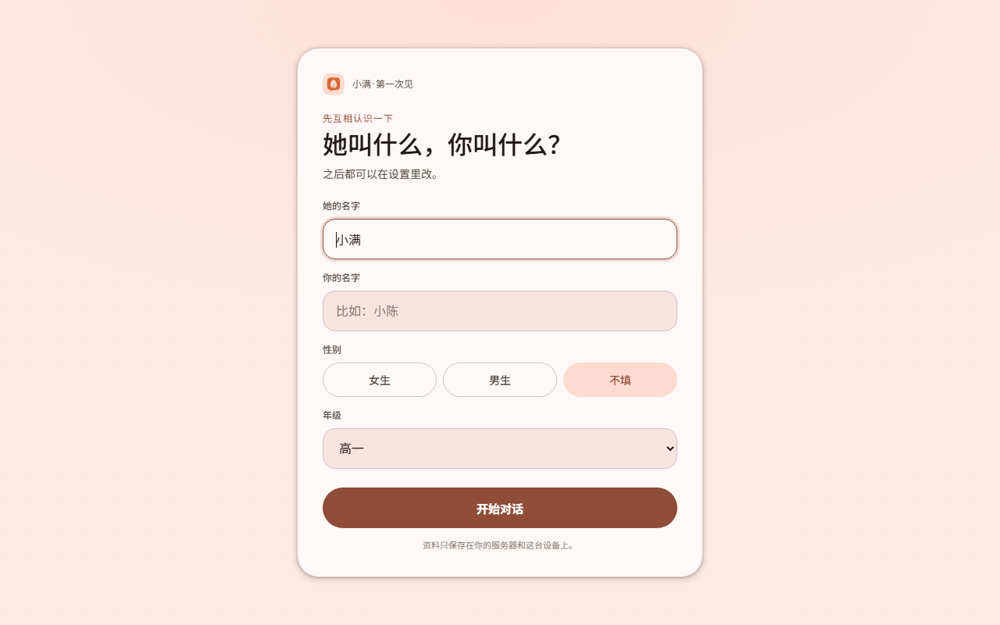
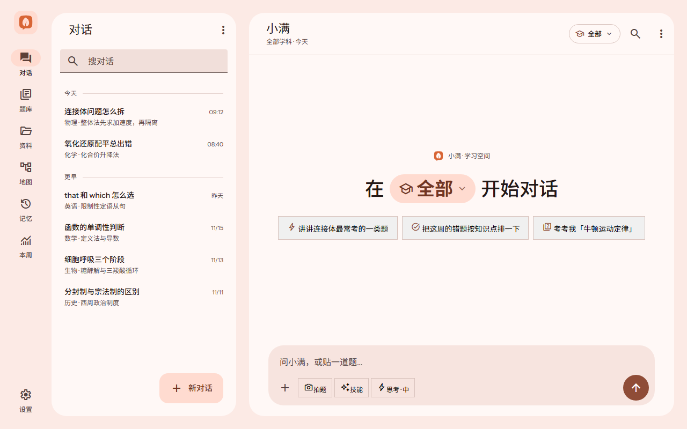
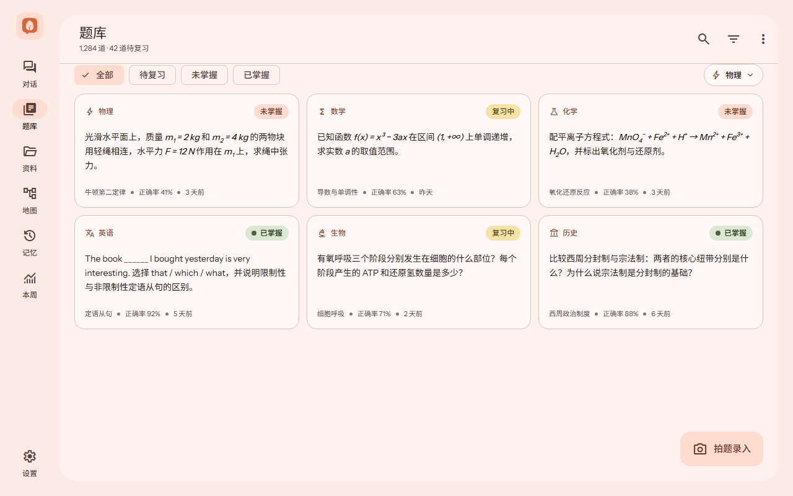
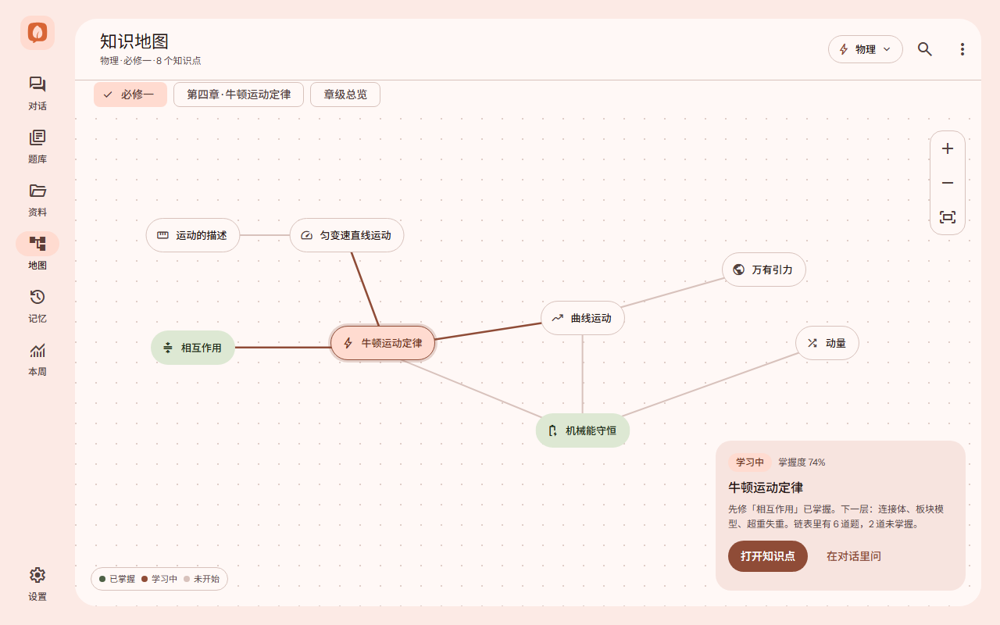
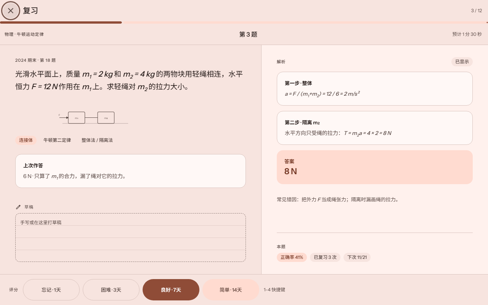
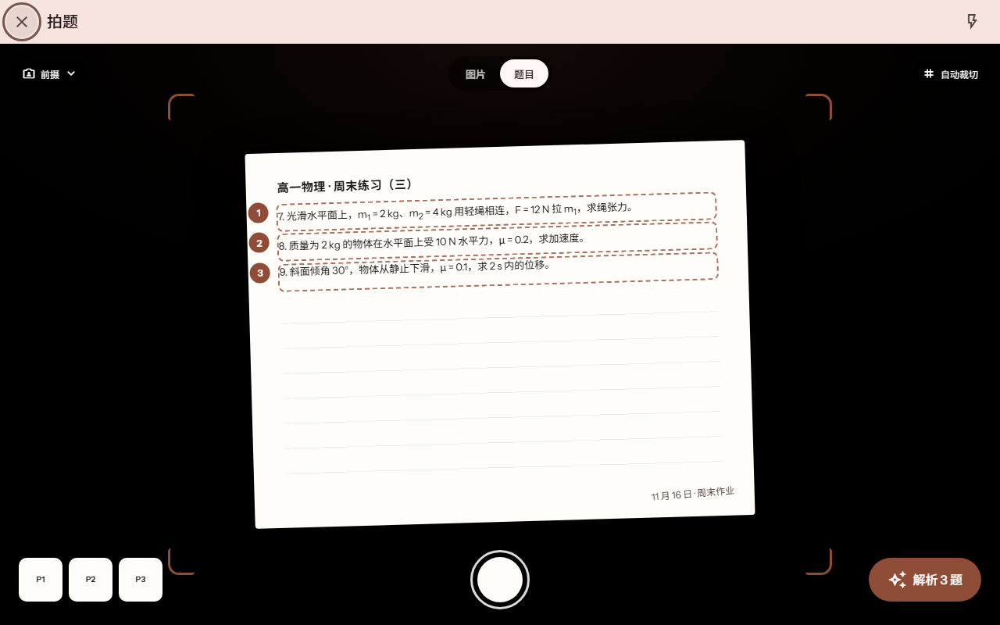
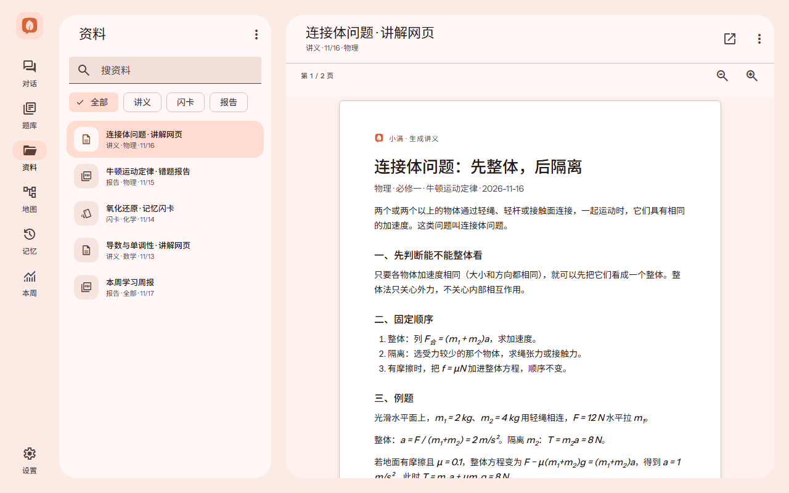
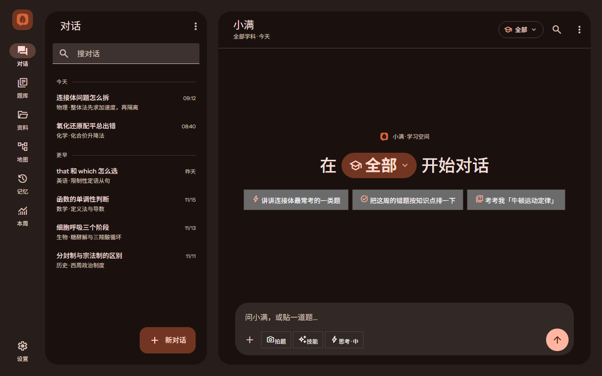
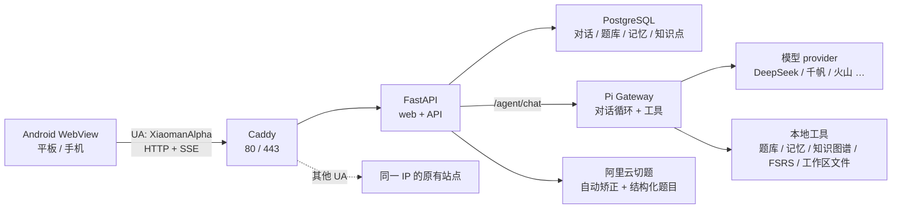

# 小满 · Xiaoman

> **基于 Pi 的个人学习助手 agent。**
> 不是「又一个学习 App」——是一个会先开口、会记住、会安排复习的学习伙伴。

<p>
  
  
  
  
</p>

小满是一个**单用户、自托管**的学习 agent：对话是入口，题库、知识点地图、FSRS 复习、资料与周报是它自己长出来的结构。数据只在自己的服务器上，没有账号、没有多租户、没有订阅。

当前版本：**alpha 0.2**（Android WebView 壳 + 平板优先的 Web 界面；APK 不内置服务器地址）。



---

## 为什么做小满

学习里真正断掉的不是「答案」，而是三件事：

- **痕迹不落库**：问完就散了，错题和不会的点没有留下来；
- **落库不关联**：题目、知识点、教材各在一处，形不成网；
- **关联不复发**：看懂了，但没有人按时把它再推回来。

小满把这三段接起来：**对话即采集 → 自动结构化 → 知识关联 → FSRS 复习**。答案给完，系统才开始工作。

---

## 功能

| | |
|---|---|
| **对话即采集** | 文字、图片、题目都可以直接丢进来；她从对话里识别题目与知识点 |
| **九科学科空间** | 语文 / 数学 / 英语 / 物理 / 化学 / 生物 / 政治 / 历史 / 地理，切换学科 = 换空间 |
| **题库** | 题干、答案、解析、知识点、年级、难度；按状态筛选，右侧详情 |
| **知识地图** | 一科一张知识点网：模块 / 章 / 先修链 / 搜索定位 |
| **FSRS 复习** | 每天到期队列，四档评分；`review_log` 只追加，用于训练参数 |
| **资料与技能** | 讲解网页、PDF 讲义、错题报告、知识卡片、记忆闪卡 |
| **记忆** | 她记住的偏好 / 约定 / 事实，可查看、可修改、可删除 |
| **本周** | 消息、活跃天、连续天数、学科分布 |
| **首次引导** | 第一次打开先给她起名字，再填你的名字 / 性别 / 年级，然后开始对话 |
| **首次连接** | APK 不写死服务器；第一次填 IP / 地址，连接成功后自动记住 |
| **试卷分析** | 上传整套试卷照片，生成结构 / 分值 / 知识点分布 / 失分点的分析页，存进资料库 |
| **资料库** | 网页、PDF、卡片、闪卡，以及「试卷」类型；可从资料库直接添加试卷 |
| **深色模式** | 只换 token，布局不变 |

### 截图

| 首次引导 | 对话 |
|---|---|
|  |  |

| 题库 | 知识地图 |
|---|---|
|  |  |

| 复习 | 拍题 |
|---|---|
|  |  |

| 资料库 | 深色模式 |
|---|---|
|  |  |

> 截图按 1280×800 平板横屏渲染；同一套界面在 800×1280 竖屏与 1024×768 下会自动收成单栏 / 双栏。设计说明见 [`docs/40`](docs/40-MD3平板界面重设计.md)。

---

## 架构



- **Web**：无构建的原生 HTML / CSS / JS，平板优先，MD3 设计语言；服务器直接托管。
- **API**：FastAPI + SQLAlchemy 2 + PostgreSQL；确定性业务（复习调度、图谱、检索）在服务端，不交给模型猜。
- **Agent**：Pi 负责对话循环、模型、工具调用；小满只加领域工具和 prompt。
- **Android**：系统 WebView 的轻量壳，只做外壳、返回、文件选择、前摄拍题和状态栏，不重复实现 UI。
- **连接**：APK 首次启动填服务器地址；WebView 的 UA 带 `XiaomanAlpha/0.2` 前缀，Caddy 按 UA 分流到小满，不占路径、不开新端口。裸 IP 根路径仍归原有站点。
- **OCR / 切题**：云 API；默认开启 `image_correction`，坐标仍按原图返回，复核框不会偏。

### 仓库结构

```text
xiaoman/
├── web/                 # 正式版 Web UI（平板优先）
├── server/              # FastAPI + SQLAlchemy + Alembic
├── agent/               # Pi 网关（Node/TS）+ 技能
├── android/             # Android 系统 WebView 壳（Java）
├── design/mockup/       # 设计稿与截图
├── docs/                # 需求、技术选型、界面、视觉、路线图
└── .github/workflows/   # Android APK 构建与 alpha 发布
```

---

## 快速开始

### 1. 后端

```bash
cd server
python -m venv .venv
# Windows
.venv\Scripts\pip install -r requirements.txt
# macOS / Linux
# .venv/bin/pip install -r requirements.txt

cp .env.example .env      # 填 DATABASE_URL、PAPERCUT_* 等
.venv\Scripts\alembic upgrade head
.venv\Scripts\python -m uvicorn app.main:app --host 0.0.0.0 --port 8787
```

> PostgreSQL 需要先建库；`DATABASE_URL` 示例见 `server/.env.example`。  
> `server/.env` 已被 `.gitignore` 排除，不要提交密钥。

### 2. Agent 网关

```bash
cd agent
npm install
node server.mjs
```

Pi 的模型目录 / 认证在 `agent/.pi-home`，同样不入库。模型可以先在界面里连一个 OpenAI 兼容端点。

### 3. 打开 Web

浏览器访问 `http://127.0.0.1:8787/`。第一次会进入引导：给她起名字、填你的名字 / 性别 / 年级，然后开始对话。

### 4. Android

从 [Releases](https://github.com/cyychenyiyicyy/xiaoman/releases) 下载 alpha APK，或自己构建：

```bash
cd android
gradle assembleDebug
# 产物：android/app/build/outputs/apk/debug/app-debug.apk
```

APK **不内置任何服务器地址**。第一次打开会显示「连接小满」：填 IP / 地址，点连接；验证 `/health` 通过后保存到本地，以后自动连接。服务器不可达时会显示离线页，里面可以「更换服务器」。支持平板与手机、横竖屏、前摄拍题、文件选择与系统返回。

### 5. 部署到自己的服务器

服务器上只需要拉代码、装依赖、重启两个进程：

```bash
cd /srv/xiaoman
git pull
server/.venv/bin/pip install -r server/requirements.txt
server/.venv/bin/alembic upgrade head     # 没有新迁移时是空操作
# 重启 API（systemd / docker compose / 你的进程管理方式）
# 重启 Pi 网关：cd agent && node server.mjs
```

> 首次引导会把资料写进 `app_setting`，不需要新建表。  
> 服务器没有登录体系；公网访问请加反向代理鉴权或 Tailscale。

---

## 当前状态（alpha 0.2）

| 已可用 | 说明 |
|---|---|
| 首次引导 | agent 名字 + 用户名字 / 性别 / 年级；存服务器 `app_setting`，本地也缓存一份 |
| 首次连接 | APK 不内置服务器；填 IP / 地址，验证后保存，之后自动连接 |
| MD3 正式版界面 | 对话 / 题库 / 资料 / 地图 / 记忆 / 本周 / 设置 / 复习 / 拍题，平板双栏、手机单栏 |
| 拍题 | 前摄取景，默认自动矫正；复核框按原图坐标 |
| 题库 / 知识点 / 复习 | 解析、知识点、每日到期、FSRS 评分 |
| 试卷分析 | 整套试卷照片 → 结构 / 分值 / 知识点分布 / 失分点报告，存为「试卷」资料 |
| 技能 | 讲解网页 / PDF / 错题报告 / 知识卡片 / 记忆闪卡 / 试卷分析 |
| Android APK | GitHub Actions 构建 debug APK，tag `v*` 自动发 prerelease |

**已知限制**

- 单用户、默认无登录；不要直接暴露到公网而不加鉴权 / Tailscale。
- WebView 需要较新的 Chromium（建议 ≥ 125）；旧学习机的 WebView 会退化。
- 多端数据还不互通；手机 / 平板各自本地缓存设置。
- 题目切分依赖云 API；复杂版面、手写、跨页仍可能漏题。
- 桌面端、Linux 服务端尚未开始（见下）。

---

## Roadmap

| 方向 | 状态 | 说明 |
|---|---|---|
| 多端互联 | **暂缓** | 以服务器为准的资料 / 题库 / 复习记录同步；先做鉴权与增量同步协议 |
| Windows 桌面版 | **暂缓** | 轻量 WebView2 / Tauri 壳，复用同一套 Web UI |
| Linux 桌面 + 服务器端 | **暂缓** | 桌面端带界面；服务器端无界面，只跑 API / agent / 同步 |
| 当前优先级 | alpha 打磨 | 首次引导细节、拍题准确率、Android 旧 WebView 兼容、错误恢复 |

> 路线图的详细拆分见 [`docs/41-路线图与多端计划.md`](docs/41-路线图与多端计划.md)。

---

## 设计

- 视觉：Material Design 3 + [MICL](https://github.com/henkpb/micl)；赤陶 `#B0563A` 作为种子色生成 M3 角色。
- 平板：1280×800 为基准，导航 rail 96 / 列表 344 / 阅读栏 720；打开详情时列表收起，换成「对话 + 右栏」。
- 字体：Instrument Sans（拉丁 / 数字）+ 系统中文字体；Material Symbols 图标。
- 设计稿与截图：[`design/mockup/md3/`](design/mockup/md3/)；规范：[`docs/40`](docs/40-MD3平板界面重设计.md)。

---

## 文档

| 想了解 | 读 |
|---|---|
| 为什么做、做给谁 | [`docs/01`](docs/01-需求分析.md) |
| 技术选型与架构 | [`docs/04`](docs/04-技术选型与架构.md) |
| AI 运行时与工具 | [`docs/06`](docs/06-AI运行时与工具设计.md) |
| 界面清单 / 平板布局 | [`docs/08`](docs/08-界面设计-页面清单与规范.md) · [`docs/09`](docs/09-平板界面设计.md) |
| 视觉系统 | [`docs/12`](docs/12-视觉系统v3.md) |
| MD3 平板重设计 | [`docs/40`](docs/40-MD3平板界面重设计.md) |
| 路线图与多端计划 | [`docs/41`](docs/41-路线图与多端计划.md) |
| 部署（systemd / PostgreSQL / Caddy UA 分流） | [`deploy/README.md`](deploy/README.md) |

---

## License

[MIT](LICENSE) © 2026 cyychenyiyicyy

## Acknowledgements

- [Pi](https://www.npmjs.com/package/@earendil-works/pi-coding-agent) — agent 运行时
- [FSRS](https://github.com/open-spaced-repetition/py-fsrs) — 间隔重复
- [MICL](https://github.com/henkpb/micl) — Material 3 组件
- [Material Symbols](https://fonts.google.com/icons) · [KaTeX](https://katex.org/) · [Cytoscape.js](https://js.cytoscape.org/)
- 阿里云试卷切题 OCR

> 小满是一个自用项目，不提供托管服务，也不做多租户 / 班级 / 分享。
