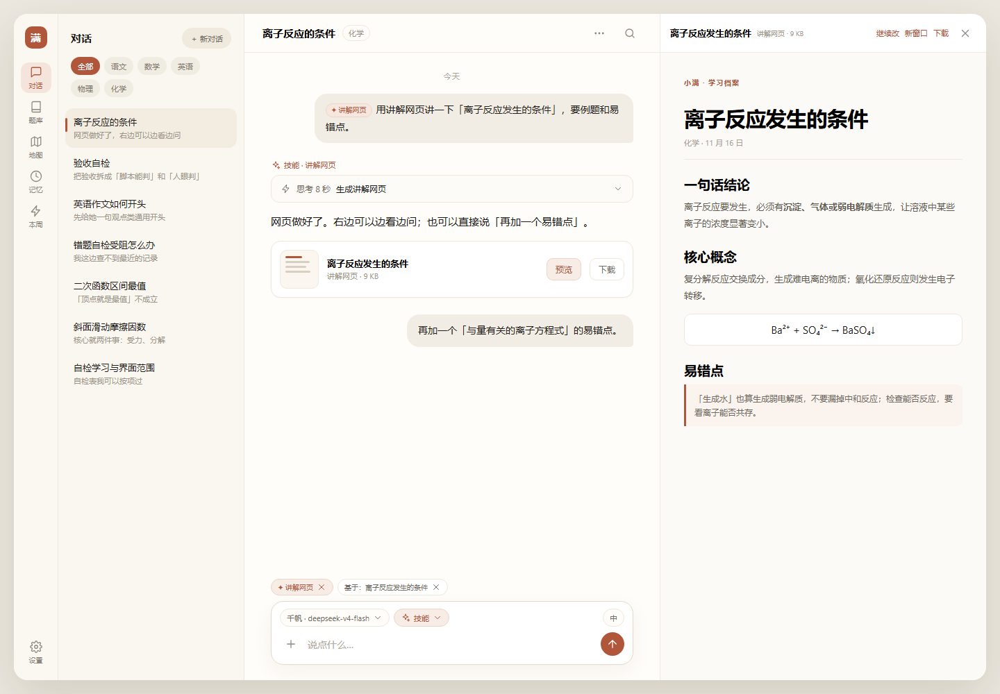
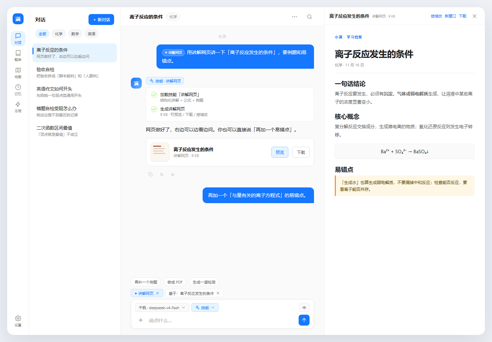
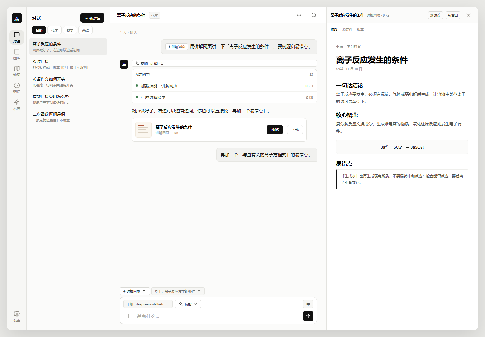

# 37 · 设计组件规范与框架评估（Ant Design X / Astryx）

> **2026-11-16 已选方向 A，落地见 [docs/38](38-新对话页与A方向落地.md)。**
>
> 结论先说：**两个框架都不能直接套进现在的小满 Web**。
> 它们都是 React 组件库/设计系统，而小满前端是**零构建的原生 JS + 一套 token CSS**。
> 能直接借的是它们的**组件结构、状态和 token 方法**，不是 npm 包。
> 下面给出三份方向稿（示意图）、一份组件规范，以及三条可选路线与成本。

---

## 1. 两个项目到底是什么

### Ant Design X

- React 组件库 `@ant-design/x`，蚂蚁出品，**专为 AI 对话界面**；
- 组件：`Bubble` / `Bubble.List`、`Sender`、`Conversations`、`Prompts`、`Suggestion`、`Think`、`ThoughtChain`、`Actions`、`Welcome`、`Attachments`、`Sources`、`FileCard`、`CodeHighlighter`、`Mermaid`、`XProvider`；
- 2.0 要求 **Ant Design v6 + React 18/19**，底层 CSS-in-JS，需要打包器；
- 适合：从零做 React 的 AI 对话产品；不适合：往原生 DOM 页面里"贴一段"。

来源：[Ant Design X 介绍](https://x.ant.design/components/introduce)、[2.0 发布说明](https://github.com/ant-design/x/issues/1358)、[React 安装](https://1x-ant-design-x.antgroup.com/docs/react/introduce)

### Astryx

- Meta 开源的 **通用设计系统**（Beta）：React + StyleX，150+ 可访问组件、品牌级主题、深色模式、模板、CLI；
- 它不是聊天组件库，更像「企业级组件 + token + 主题」的整套底座；
- 同样需要 React + StyleX 构建链，且仍在 Beta；
- 注意：另有一个 Flutter 包 `astryx_ui` 和一个 npm 上的 `astryx-ui`，都不是 Meta 这个；这里按 Meta Astryx 评估。

来源：[Introducing Astryx by Meta](https://astryx.atmeta.com/blog/introducing-astryx)

### 为什么不能直接套

| 约束 | 现状 | Ant Design X | Astryx |
|---|---|---|---|
| 前端框架 | 原生 JS（`web/app.js` 约 6k 行），无构建 | React 18/19 | React + StyleX |
| 接入方式 | FastAPI 直接托管静态文件 | 需要 React root/打包 | 需要 StyleX 编译 |
| 依赖体量 | 零前端依赖，仅本地 KaTeX/Cytoscape | antd v6 + antx + CSS-in-JS | React + StyleX + 组件包 |
| 聊天专用 | 自研消息/工具/产物 | ✅ 强 | ❌ 通用组件 |
| 与现有交互 | 长按/胶囊/资料预览/技能 | 需重写事件与状态 | 需重写事件与状态 |

**直接套 = 换前端框架重写，而不是换皮肤。** 对"维护十年、单用户、依赖压到最低"的项目，这一刀不划算。

---

## 2. 三条路线与成本

| 路线 | 做法 | 成本 | 风险 | 适合 |
|---|---|---|---|---|
| **A. 保留原生，借结构**（推荐） | 保留 `app.js`；按 AntX 的 Bubble/Sender/ThoughtChain 结构 + Astryx 的 token 方法重做组件层 | 中 | 低 | 当前项目 |
| **B. React 孤岛** | 只把对话区用 React + AntX 重写，挂进现有 shell；其余页面保留 | 中高 | 中 | 想快速拿到 AntX 观感 |
| **C. 全量 React 迁移** | 整个 Web 改 React + AntX（或 Astryx） | 高 | 高（6 屏交互 + 状态全重写） | 愿意重做前端 |

> 如果一定要"套框架"，唯一可控的是 **B**：一个 `ChatRoot` React 孤岛 + 事件桥；
> 但仍然要加 Vite/React 构建、antd 主题、与原生路由/状态同步。预计 3–5 天起步，且样式会与现有页面割裂。

---

## 3. 三份示意图稿

三张都是 1440×1000 的真实 HTML 渲染，文件在 `design/mockup/agent-ui/`。

### 方向 A · 小满纸感（精修当前）

保留赤陶 + 纸色 + 大留白，把消息、工具链、产物卡、输入框收紧成组件。
最贴近现在的品牌，改动量最小。

- 文件：[a-warm.html](../design/mockup/agent-ui/a-warm.html)
- 关键词：纸色、赤陶、18px 气泡、14px 卡片、轻描边

### 方向 B · Ant Design X 原生观感

蓝色主色、头像 + 气泡、ThoughtChain 步骤、Actions、Prompts、Sender。
最像主流 AI 产品，但和小满的赤陶识别会冲突（可把蓝色替换成赤陶）。

- 文件：[b-antx.html](../design/mockup/agent-ui/b-antx.html)
- 关键词：Ant Blue、12px 气泡、8px 控件、垂直思考链、建议 chips

### 方向 C · Astryx 风格（中性 / 紧凑）

黑白灰 + 小圆角 + 高密度 + 细边框，工具调用做成 Activity 面板，右侧带「预览/源文件/版本」标签。
更像企业 Agent 工作台。

- 文件：[c-astryx.html](../design/mockup/agent-ui/c-astryx.html)
- 关键词：单色、13px、6–8px 圆角、ACTIVITY、tab

> 我的建议：**A 的底色 + B 的思考链/发送器结构**。
> 小满的识别是"纸和赤陶"，不必为了像 Agent 而变成蓝白聊天框；B 的结构比皮肤更值得借。

---

## 4. 设计组件规范（v1）

### 4.1 Foundations

**颜色**（全部走 token，禁止裸 hex）

| Token | 值 | 用途 |
|---|---|---|
| `--paper` | `#FBFAF7` | 页面底 |
| `--card` | `#FFFFFF` | 卡片/输入框 |
| `--fill` | `#F3EFE7` | 用户气泡/次级面 |
| `--ink` | `#1A1917` | 主文字 |
| `--ink2` | `#6E6A62` | 次文字 |
| `--ink3` | `#A09B90` | 说明/占位 |
| `--line` | `#E8E4DA` | 分隔线 |
| `--line2` | `#D9D3C6` | 控件描边 |
| `--clay` | `#B0563A` | 唯一主色 |
| `--claybg` | `#F8EDE8` | 主色浅底 |
| `--on-clay` | `#FFFFFF` / 深色下 `#1A1917` | 赤陶上的文字 |
| `--sage` | `#5F7355` | 只用于"已掌握/成功" |
| `--focus` | `rgba(176,86,58,.22)` | 聚焦光晕 |

**字号**：34 / 24 / 19 / 15 / 13 / 11；字重 400 / 500 / 600。
**行高**：1.2（大标题）/ 1.35 / 1.5 / 1.6 / 1.75（正文）。
**间距**：4 / 8 / 12 / 20 / 32 / 52。
**圆角**：999（胶囊）/ 18（输入框）/ 16（卡片）/ 14（产物卡）/ 10（缩略图）/ 8（控件）/ 4（tag）。
**高度**：44（最小热区）/ 48（主操作）/ 36（紧凑）/ 32（图标按钮）。
**阴影**：`0 1px 2px rgba(42,33,18,.04)`、`0 10px 30px rgba(60,45,20,.06)`。
**动效**：120ms / 180ms，`ease-out`；不做弹跳。

### 4.2 组件清单

| 组件 | 规格 | 状态 | AntX 对应 | Astryx 参考 |
|---|---|---|---|---|
| **AppShell** | 20px 外边距，20px 圆角，rail 64 + side 268 + main + preview 42vw | 默认/预览开 | Layout | App shell |
| **Rail** | 64 宽，图标 22，label 10/11，active 赤陶 10% 底 | hover/active | Conversations 的侧栏 | Sidebar |
| **ConversationItem** | 高 56，13/11 两行，选中左 3px 赤陶条 | default/hover/active | Conversations | List item |
| **TopBar** | 56 高，标题 15/600，右侧 34 图标 | default | — | Page header |
| **UserBubble** | 最大 82%，padding 9/16，圆角 18/5，`--fill` | default/sending | Bubble | Chat surface |
| **SkillChip（消息内）** | 高 20，padding 0 7，11px，赤陶浅底，和正文同一行 | default | Bubble header/tag | Badge |
| **AssistantMessage** | 无气泡，15/1.8，`--ink`；顶部 skill line 11 赤陶 | streaming/done/error | Bubble（left） | Chat message |
| **ToolTrace** | 折叠条高 40，边框 `--line`，圆角 12；展开每步 44 | collapsed/expanded/running/error | ThoughtChain / Think | Activity |
| **ArtifactCard** | padding 12，缩略图 52，标题 13/600，meta 11，按钮 32 | default/hover | Attachment/FileCard | Card |
| **Composer** | 圆角 18，padding 10，focus 3px 光晕；工具行 26；send 34 | idle/focus/sending | Sender | Field |
| **ModelPill / SkillPill** | 高 26，11px，圆点/图标 + 文 + chevron | default/active | Sender header | Select |
| **ContextChip** | 高 24，11px，`基于：标题 ×` | default | Attachments | Tag |
| **LibraryCard** | 2 列，padding 12，缩略图 52，kebab 32 | default/hover/menu | — | Card |
| **PreviewPane** | 42vw/680，头 56，iframe/object/img | open/closed | Artifacts panel | Panel |
| **Sheet** | scrim + 顶部圆角 20 + grab + 56 头 + 右上 44 × | open | Modal | Dialog |
| **Empty/Error/Skeleton** | 空态一个动作；错误一条退路；骨架 3 行 | — | — | EmptyState |

### 4.3 交互规则

- 所有可点目标 ≥ 44（桌面 36 紧凑，但热区补到 44）；
- 一屏最多一个 filled 主按钮（发送或主 CTA）；
- 技能/上下文胶囊在输入框内，发送后消息里保留同款小胶囊；
- 工具调用默认折叠成一行，展开才看步骤；
- 深色只换 token，不写 `if(dark)`；
- 无 emoji 图标；图标统一 1.7 描边；
- 过渡只做颜色/边框/位移 1–2px，不做弹跳。

### 4.4 与 AntX / Astryx 的映射

| 小满组件 | Ant Design X | Astryx |
|---|---|---|
| 消息列表 | `Bubble.List` | Chat surface |
| 用户气泡 | `Bubble` | — |
| 输入框 | `Sender` | Field + Button |
| 技能/附件胶囊 | `Sender` header/Attachments | Tag |
| 工具链 | `ThoughtChain` / `Think` | Activity/Timeline |
| 建议 | `Prompts` / `Suggestion` | — |
| 会话侧栏 | `Conversations` | Sidebar |
| 主题 | `XProvider` | Token/Themes |
| 预览面板 | Artifacts（示例） | Panel |

**借结构，不借运行时**：这就是路线 A。

---

## 5. 实施计划（选方向后）

1. **拍板方向**（A / B / C，或 A+B 混合）；
2. 把 `theme.css` 的 token 收敛成 primitive → semantic → component 三层（现有变量可直接改名）；
3. 新建 `web/components.css`，按上表落 14 个组件类；
4. 先重写「对话 + 输入框 + 工具链 + 产物卡」，再改资料库/预览；
5. 每个组件出 3 张图（浅色/深色/手机），跑 `ui-*` 冒烟；
6. 保留 `app.js` 事件模型，只替换渲染函数，避免一次性重写。

若选 B（React 孤岛），额外需要：
- Vite + React + `@ant-design/x` + `antd`；
- 一个 `ChatRoot` 挂载点与 `window.XM` 事件桥；
- AntX 主题 token 映射到赤陶；
- 原生页面与 React 页面的路由/滚动/选中态同步。

---

## 6. 结论

- **Ant Design X**：聊天组件最全，但 React-only，直接套 = 前端重写；
- **Astryx**：通用设计系统、Beta、React + StyleX，同样不是"换皮即用"；
- **推荐**：路线 A，保留原生，按 AntX 的 **Bubble / Sender / ThoughtChain / Actions** 结构 + Astryx 的 **token 分层**重做组件；
- 视觉方向建议 **A 的纸感**，把 B 的思考链和发送器结构借过来，形成"小满自己的 Agent 脸"。

选 A / B / C 哪个，我就按对应路线开始落组件。
