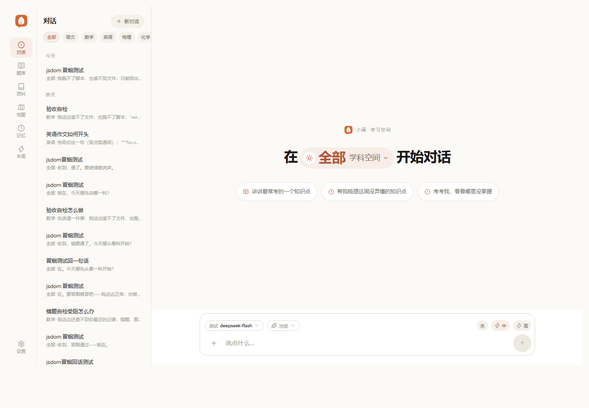
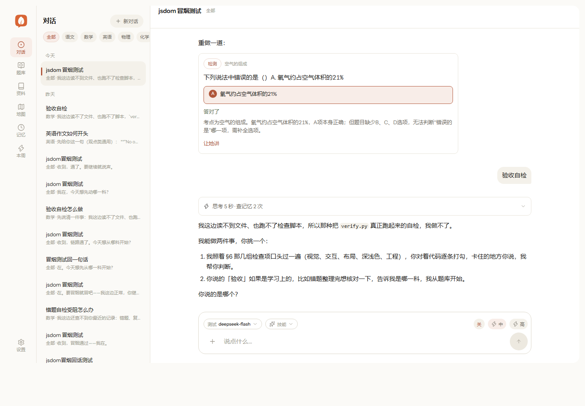

# 38 · A 方向落地：新对话页、Logo 与纸感组件

> 选了方向 A（小满纸感），这一版把「新对话页」重做，并把 Logo、侧栏、顶栏、输入框、
> 消息节奏统一到 A 稿的纸感组件上。

代码：`web/index.html` · `web/app.js` · `web/theme.css` · `web/logo.svg`
设计依据：[docs/37](37-设计组件规范与框架评估.md)

---

## 1. 新对话页

没有选中会话时，主区域不再是「还没有选中对话」的空态，而是一个真正的开始页：

```
小满 · 学习空间

      在  [🧪] 化学  学科空间 ⌄  开始对话

  [ 讲讲化学里最常考的一个知识点 ] [ 帮我梳理这周没弄懂的知识点 ] [ 考考我「化学」… ]

  ┌─────────────────────────────────────────────┐
  │ [千帆 · deepseek-v4-flash] [✦ 技能]     关 中 高 │
  │ ＋  说点什么…                              ↑  │
  └─────────────────────────────────────────────┘
```

- 大标题：`在` + 学科按钮 + `开始对话`；学科按钮里有 **学科图标 + 学科名 + 学科空间 + ⌄**；
- 点学科按钮 → 学科空间弹层（全部 + 九科，带图标和勾选），切换后标题和推荐语立即更新；
- 下面三个 **推荐气泡**，点击直接以当前学科开始一个新会话并发送这句话；
- 底部输入框保持原样：模型胶囊、技能胶囊、思考档位、附件、发送；
- 顶栏在新对话页隐藏，避免和标题重复；进入会话后恢复。

细则：

| 项 | 值 |
|---|---|
| 标题字号 | 34 / 行高 1.48 / 600；手机 24 |
| 学科按钮 | clay 浅底胶囊，图标 30，学科名 34/600，学科空间 19/400，chevron 16 |
| 推荐气泡 | 高 46，圆角 999，1px line，图标 14 clay，hover 描边加深 |
| 推荐语 | 随当前学科变化；「全部」时用通用说法 |
| 发送行为 | 新建 conversation（subject = 当前学科）→ 立即发送；不弹额外选择 |



---

## 2. Logo

用户提供的新 Logo（橙色对话气泡 + 留白芽形）：

- 源文件：`design/brand/logo-new.svg`（900×900）；
- 站点：`web/logo.svg`，替换 rail 原「满」字方块；
- favicon：`<link rel="icon" href="logo.svg">`；
- 新对话页 brand 行：24px Logo + 「小满 · 学习空间」；
- 深浅色都用原色（橙 #D86535），在纸色和深色底上都成立。


---

## 3. A 方向适配

| 位置 | 改动 |
|---|---|
| 外壳 | 桌面 14px 留白 + 20px/16px 圆角，像一张浮起来的纸卡 |
| Rail | 68/72 宽，Logo 36，active 赤陶浅底；图标/文字保持 1.7 描边 |
| 对话侧栏 | 280 宽，品牌 16、选中卡片 12 圆角 + 左侧 3px 赤陶条、日期 11 字距 |
| 顶栏 | 56 高，标题 15/600；新对话页隐藏 |
| 消息 | 用户气泡 18/5 圆角、内嵌技能小胶囊；助手 15/1.8，工具链 40 高 |
| 输入框 | 18 圆角，聚焦 3px clay 光晕；技能/基于资料胶囊在文字前 |
| 资料/预览 | 沿用上一版，卡片圆角、缩略图、更多菜单 |

### 一个隐藏 Bug

新对话页最初样式写成 `.hero{display:flex;...}`，同时 `document.body.classList.add('hero')`，
结果 **body 本身被当成 hero 容器**，出现整页缩小、居中、左侧大留白。
现已把 body 状态类改名 `is-hero`，`.hero` 只作用于主内容。



---

## 4. 行为变化

- 侧栏「新对话」不再弹学科选择，直接进入新对话页（学科在标题里选）；
- `#library` / `#bank` / `#map` 深链不再先等 `loadMessages`，打开更快；
- 新建会话时清空旧消息，避免「新会话里混入上一个学科的消息」；
- `loadMessages` 对本地占位消息和刚落库消息做角色+正文去重，避免发送瞬间出现两条相同消息。

---

## 5. 验收

- `ui-hero`：**12 PASS**（标题、学科下拉、3 个推荐、输入框、Logo、顶栏隐藏、切学科、点击推荐进入会话）
- 回归：题库 19、地图 18、主题 12、技能 7、资料库 18、学习闭环 13
- `verify`：**40 PASS / 0 FAIL / 1 SKIP**

---

## 6. 还没做

| 项 | 说明 |
|---|---|
| 其余一级页 | 题库/地图/设置已沿用 token，但还没逐个按 A 稿重写内部卡片 |
| 手机新对话页 | 已有响应式（标题 24、推荐竖排），还没在真机验 |
| 推荐语 | 目前固定三条；以后可以按最近薄弱点动态生成 |
| Logo 动效 | 还没有加载/思考态动效；先保持静态 |
